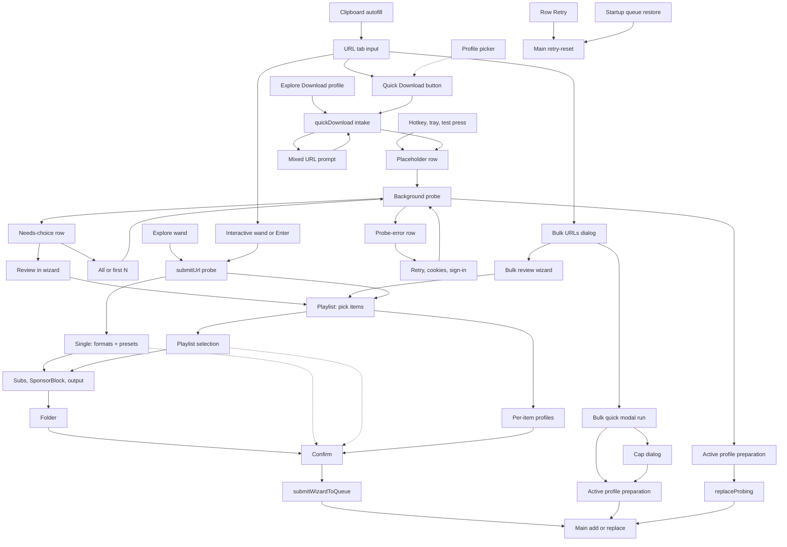

# Download Workflows Map

Every path that ends with something in the download queue, with the file that
owns each step. Read this before changing an entry point, a wizard step, or
how settings turn into a job, instead of re-tracing the code.

Verified against `main` @ `34e8dd68` (2026-10-17). Line numbers drift: trust
the function names, re-check the numbers. Update this file in the same PR when
a workflow, step, or settings source changes.

## The two queue writes

The renderer adds to the queue through exactly two IPC commands,
`queue.cmd.add` and `queue.cmd.replaceProbing`, issued from
`src/renderer/src/store/quickDownload/quickDownloadPipeline.ts` (background
single-link path) and `src/renderer/src/store/wizard/queueSubmissionAdapter.ts`
(wizard, bulk quick run, playlist cap dialog). Main admits, dedupes and
commits them in `src/main/services/QueueService.ts`.

## Current map

Dotted edges into Confirm are `skipToConfirm`. The dotted Profile picker edge
sets the active profile that Quick Download uses.

## Entry points

| Node | What happens | Settings source | Owner |
| --- | --- | --- | --- |
| URL | Link field; Enter runs the wizard, not Quick Download | — | `DownloadProfilesHome` |
| CLIP | Clipboard watch only fills the field, never queues | — | `DownloadProfilesHome`, `clipboardIntake.ts`, `ClipboardWatcher` |
| QBTN, PICK | Quick Download with the active profile; the arrow switches it | active profile | `DownloadProfilesHome`, `systemSlice.setActiveDownloadProfile` |
| EXD, EXW | Explore's Download button (quick) and wand (`submitUrl('explore')`, returns to Explore) | active profile / wizard | `ExploreTab`, `probeOrchestrator` |
| HK | Hotkey chord, tray item, or Settings test press; a mixed URL is forced to its video | active profile | `HotkeyService`, `hotkeyTrigger.ts`, `urlIntentPolicy.ts` |
| QD, MIX | Cleans the URL, blocks on incomplete cookies setup, asks video-or-list for mixed URLs | — | `quickDownloadSlice.quickDownload` |
| PLC → SWAP | Pins the active profile on a placeholder row, probes in the background, then swaps in prepared items or leaves a needs-choice / probe-error row | pinned active profile | `quickDownloadPipeline.ts`, `quickProbeResolution.ts` |
| NC, PE | Rows that need the user: All / first N / Review; Retry / cookies / sign in | pinned profile; Review uses wizard selections | `QueueAttentionRow`, `quickDownloadSlice` |
| BULK, BQ, CAP | Bulk dialog: quick runs a modal probe loop (no placeholder rows, own cap dialog); otherwise the bulk wizard | active profile / wizard | `BulkUrlDialog`, `quickDownloadPreparation.ts` |
| DLR, BOOT | Retry on a resolved row re-runs its stored job; startup restores `queue.json`, stale probing rows become errors | the row's job | `queueSlice`, `QueueService`, `QueueProbeLifecycle`, `QueueAutoRetry` |

No queue row can be reopened in the wizard except a needs-choice row's Review.

## Wizard steps per mode

Step list: `wizardStepNameSchema` in `src/shared/schemas.ts`. Visibility:
`stepApplies` in `src/renderer/src/store/wizard/wizardStepGraph.ts`.

- **Single:** url → formats (preset strip) → subtitles (if the video has
  tracks) → sponsorblock (YouTube, preset makes video) → output (preset makes
  media) → folder → confirm. Up to six Continue clicks after the URL.
- **Playlist / bulk:** url → playlistItems → playlistPresets (subtitles are
  picked inside it; the separate subtitles step never shows in batch modes) →
  sponsorblock → output → folder → confirm.
- **Multi-profile (batch only):** url → playlistItems → playlistProfiles →
  confirm.

## Settings sources

Five sources feed jobs, and which one applies depends on the path:

1. **Active download profile:** Quick Download, Explore, hotkey, bulk quick.
2. **Pinned profile:** the active profile captured on a placeholder row at
   intake, so switching profiles later doesn't change queued work.
3. **Per-item profiles:** multi-profile playlist mode.
4. **Wizard selections:** single formats/subtitles/SponsorBlock/output/folder;
   playlist selection seeded from `settings.playlist.lastPlaylistSelection`.
5. **Presets** (`presetSchema`: best-quality, balanced, small-file,
   audio-only, subtitle-only): only the single-mode formats step. All five
   also exist as built-in download profiles with the same ids
   (`BUILTIN_DOWNLOAD_PROFILES`), so presets are a narrower duplicate.

## Where settings become job options

- **Profile path:** `resolveDownloadProfile` (`src/shared/downloadProfiles.ts`)
  → `prepareActiveProfileQueueSubmission` / `prepareMultiProfileQueueSubmission`
  → `profileJob` → `prepareJob` (`queueSubmission.ts`).
- **Wizard path:** `buildSingleQueueItemFromState` (single, via
  `sanitizeJobOptions`) and `buildPlaylistQueueItem` (playlist/bulk, via
  `playlistSelectionToMediaIntent`), both from `prepareManualQueueSubmission`.

Known duplication between the two:

- Three QueueItem builders repeat the row literal, filename binding and
  `prepareJob` call.
- Two converters into the same `MediaIntent` (`playlistSelectionToMediaIntent`,
  `mediaIntentFromProfileMedia`); subtitle options built twice.
- Media normalization in two places (`sanitizeJobOptions` vs
  `resolveDownloadProfile`); the playlist wizard path relies on `prepareJob`
  alone.
- Output folder, `.m3u` and format label computed differently per path.
- Two quick pipelines for the same job (placeholder rows vs the bulk modal run).
- Copied helpers: `maybeBlockIncompleteCookiesConfig` and
  `applyPlaylistProbeResult` exist in both `probeOrchestrator.ts` and
  `quickDownloadPreparation.ts`.

## yt-dlp bridge gaps

The app sends the bridge only `probe` requests and *caller* `media` /
`subtitles` requests (`CallerMediaWorkflowInput` in
`packages/yt-dlp-bridge/src/workflow.ts`). The managed planner supports
`downloadSections`, `dateAfter`, `matchFilters`, `downloadArchive`,
`breakOnExisting` and more, but the caller request type has no fields for
them, and `src/` sets none. Clips, filters, and archive-based sync each need
the field added to the caller request first. `section-download.md`'s note
that the bridge "already supports `downloadSections`, no argv plumbing
needed" is true only for the managed planner.

## Proposed direction (not decided)

Draft from the 2026-10-17 design discussion. Treat as a proposal until it has
a spec.

- **Profile as the starting point in single mode.** Replace the preset strip
  with the profile picker; every step starts pre-filled from the chosen
  profile. After the probe, land on a review screen listing Format,
  Subtitles, SponsorBlock, Extras, Save to and File name, each row opening
  its existing step as an editor. The common case becomes URL → Download.
  Editing marks the settings as changed from the profile and offers
  "Save as profile". **Open decision:** this reverses the original profiles
  spec's choice to keep presets separate (retired 2026-10-17; read it with
  `git show 34e8dd68:dev-docs/custom-quick-presets-spec.md`).
- **Clip (part of video) on the video card**, single mode only, not part of
  a profile: whole video or a start/end range, chapter shortcuts, a
  `?t=` start prefilled from the URL, approximate cuts by default with an
  exact-cut option, and a range suffix in the filename. Constraints and
  research: `section-download.md`.
- **Playlist alignment:** the playlistPresets step is the batch twin of the
  preset strip; the same profile-first treatment would remove a second
  vocabulary.
